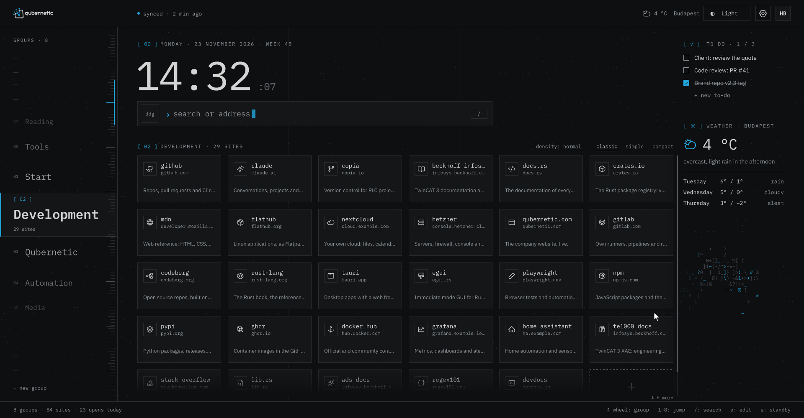

# H-Board

[](https://github.com/qubernetic/h-board/actions/workflows/ci.yml)
[](https://codecov.io/gh/qubernetic/h-board)
[](https://codecov.io/gh/qubernetic/h-board/bundles/develop/h-board-host-extension-esm)

A start page for the browser's new tab: your sites in groups you switch with a wheel, a clock, search, todos, and a
calm character field behind it all. By Qubernetic.

> **Status: concept.** This repository holds the design, an interactive HTML mock, a dev-mode browser extension and
> the plans. There is no release yet. The texts of the mock and the plans are in Hungarian.



## Three ways to use it

| | Web | Extension | Self-hosted server + extension |
|---|---|---|---|
| Runs from | `h-board.qubernetic.com` | the extension | the extension, connected to your own container |
| Your data | in the browser | in the browser | on your server, one library per user |
| Keyboard on a new tab | the browser keeps the focus in the address bar | at once | at once |
| AI agents (REST, MCP, agent keys) | no | no | yes |

The plan is in [`ideas/ARCHITECTURE.md`](ideas/ARCHITECTURE.md): one TypeScript code base, a core of commands shared
by the page, the server and its API, and a storage layer that each of the three swaps.

## What is here

| Path | What |
|---|---|
| `mock/` | The interactive mock. Serve the folder and open `index.html`: `python3 -m http.server 8790 --directory mock`. `mock/go/` routes address-bar searches (jump codes, site search). |
| `extension/` | A dev-mode Chromium extension (Manifest V3) that hands the new tab to a source address you set. Load it unpacked from `chrome://extensions`. |
| `docs/design/` (`gen/build.py`, `h-board.figcraft`, `png/`) | The design: a FigCraft file generated by the script, and its pictures. |
| `packages/` | The code of the beta, an npm workspace: `core`, `store`, `ui`, `host-extension`, `host-server`. A skeleton for now. |
| `ideas/` | The plans: architecture, requirements, feature ideas, market research and the extension-free experiment. |

## Develop

Node 22.13 or newer, npm and [`just`](https://just.systems).

```bash
npm ci                              # once per checkout
npx playwright install chromium     # once, for the smoke test
just ci                             # the gate CI runs: asset pins, lint, typecheck, tests, build, smoke test
just dev                            # the page with hot reload
just image                          # build the server image and ask its health route
```

`just build` writes the unpacked extension into `packages/host-extension/dist/`; load that folder from
`chrome://extensions`. `docker compose up --build` runs the server on `127.0.0.1:8787` (see `compose.yaml`).
The rules of the code base are in [`CLAUDE.md`](CLAUDE.md).

## Licence

Apache-2.0 (see `LICENSE`), except the Qubernetic marks (CC BY-ND 4.0) and the third-party fonts and icons listed in
[`ATTRIBUTION.md`](ATTRIBUTION.md) and `NOTICE`. "Qubernetic" and "H-Board" are trademarks of Qubernetic.
